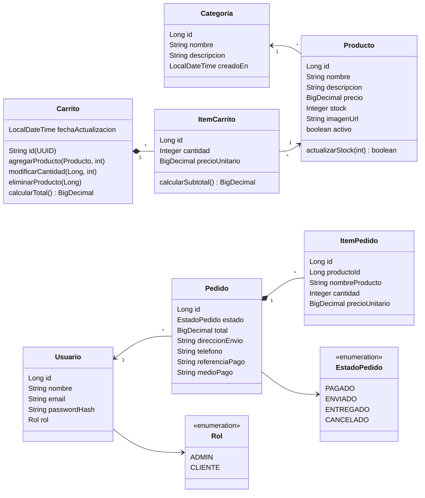
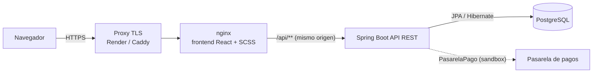
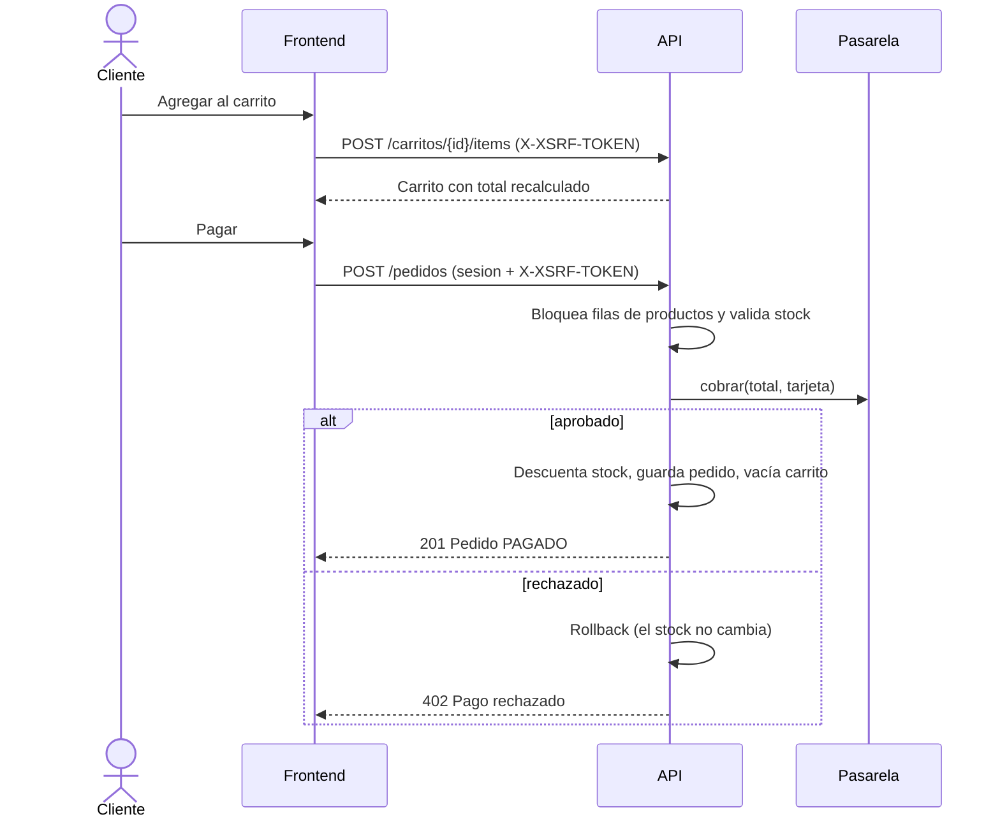

# Documento técnico — Tienda en Línea Modular

**Equipo:** Gustavo Andrés Núñez Vega y Cristian Camilo Chaparro
**Repositorios:** `tienda-modular-backend` (API REST) · `tienda-modular-frontend` (SPA)

---

## 1. Planteamiento del problema

Un pequeño negocio vende sus productos publicando fotos sueltas en redes sociales. No tiene un catálogo organizado ni control de existencias, y el cliente no puede armar un pedido con varios productos. Cada cambio de precio o producto agotado se corrige a mano en varios lugares, y nadie administra la información de forma centralizada.

## 2. Objetivos

**General.** Construir y desplegar una aplicación web de comercio electrónico con backend y frontend independientes que se comunican solo por una API REST.

**Específicos.**
1. Modelar y persistir categorías, productos, carritos, usuarios y pedidos en PostgreSQL con JPA/Hibernate.
2. Exponer una API REST documentada con OpenAPI/Swagger que un tercero pueda entender y probar sin ver el código.
3. Ofrecer un catálogo público navegable por categoría y un carrito con total recalculado en cada cambio.
4. Ofrecer un panel de administrador para que una persona sin conocimientos técnicos gestione productos, categorías y pedidos.
5. Integrar una pasarela de pagos (modo prueba) para convertir el carrito en un pedido pagado.
6. Aplicar seguridad demostrable: HTTPS, mitigación de XSS y protección CSRF.
7. Usar SCSS y un gestor de dependencias/automatizador (npm + Vite, Maven) y desplegar la aplicación de forma accesible.

## 3. Alcance

| Incluye | No incluye |
|---|---|
| Catálogo por categorías, carrito anónimo, registro e inicio de sesión | Envíos reales o cálculo de fletes |
| Panel de administrador (productos, categorías, pedidos) | Facturación electrónica |
| Pasarela de pagos en modo prueba (sandbox) | Cobros con dinero real |
| Roles ADMIN y CLIENTE | Recuperación de contraseña por correo |
| Despliegue con Docker y en Render | Aplicación móvil nativa |

## 4. Requerimientos funcionales

| Código | Requerimiento | Endpoint / pantalla |
|---|---|---|
| RF-01 | Crear categorías con nombre único | `POST /categorias` · Admin › Categorías |
| RF-02 | Editar y eliminar categorías (no se elimina si tiene productos) | `PUT/DELETE /categorias/{id}` |
| RF-03 | Crear productos asociados a una categoría, precio > 0, stock ≥ 0 | `POST /productos` · Admin › Productos |
| RF-04 | Editar y eliminar productos | `PUT/DELETE /productos/{id}` |
| RF-05 | Listar el catálogo público | `GET /productos` · Catálogo |
| RF-06 | Filtrar el catálogo por categoría sin recargar la página | `GET /productos?categoriaId=` |
| RF-07 | Agregar productos al carrito validando stock | `POST /carritos/{id}/items` |
| RF-08 | Modificar cantidades y quitar productos del carrito | `PUT/DELETE /carritos/{id}/items/{productoId}` |
| RF-09 | Calcular el total del carrito en cada cambio | `GET /carritos/{id}` (campo `total`) |
| RF-10 | Registrar clientes | `POST /auth/registro` · Crear cuenta |
| RF-11 | Iniciar y cerrar sesión | `POST /auth/login`, `/auth/logout` |
| RF-12 | Restringir el panel de administrador al rol ADMIN | Reglas en `SecurityConfig` |
| RF-13 | Pagar el carrito con la pasarela y generar el pedido | `POST /pedidos` · Pago |
| RF-14 | Consultar el historial de pedidos propio | `GET /pedidos/mios` · Mis pedidos |
| RF-15 | Consultar todos los pedidos y cambiar su estado (ADMIN) | `GET /pedidos`, `PATCH /pedidos/{id}/estado` |

## 5. Requerimientos no funcionales

| Código | Requerimiento | Cómo se cumple |
|---|---|---|
| RNF-01 | Separación backend/frontend | Dos proyectos y repositorios; el backend solo responde JSON |
| RNF-02 | Seguridad | HTTPS, CSP + limpieza de HTML (XSS), token CSRF, BCrypt, sesiones HttpOnly, roles |
| RNF-03 | Documentación de la API | OpenAPI 3 + Swagger UI en `/api/v1/docs` |
| RNF-04 | Integridad de datos | Restricciones en BD (`CHECK`, `UNIQUE`, FK), transacciones y bloqueo de fila en el pago |
| RNF-05 | Usabilidad | Interfaz en español, estados de carga/error/vacío, mensajes claros, diseño responsive |
| RNF-06 | Mantenibilidad | Capas controller/service/repository, DTOs, SCSS modular (variables, mixins, módulos) |
| RNF-07 | Disponibilidad | Imágenes Docker y despliegue en la nube accesible desde cualquier equipo |
| RNF-08 | Calidad | Pruebas automáticas en backend (JUnit) y frontend (Vitest) |

## 6. Modelo de datos

**Decisiones del modelo**
- `ItemPedido` guarda una copia del nombre y precio del producto (sin llave foránea), así el historial no cambia si el producto se edita o se elimina.
- El carrito es anónimo (UUID guardado en el navegador): se puede comprar sin crear cuenta hasta el momento de pagar.
- `ItemCarrito.precioUnitario` se sincroniza con el precio vigente cada vez que se consulta el carrito.
- Restricciones en la base de datos: `precio > 0 AND stock >= 0`, nombre de categoría único, correo de usuario único y un producto por carrito (`carrito_id, producto_id`).

## 7. Arquitectura

- **Frontend** (React 19 + TypeScript + Vite + SCSS): SPA con React Router. No contiene reglas de negocio: todos los totales, el stock y los permisos los decide la API.
- **Backend** (Spring Boot 3.5, Java 21): capas `controller → service → repository`, DTOs con Bean Validation, errores uniformes `ApiError` y Spring Security.
- **Mismo origen.** El frontend llama a `/api/v1`; en desarrollo Vite reenvía al backend y en producción lo hace nginx. Así la cookie de sesión (HttpOnly) y la cookie CSRF funcionan sin abrir CORS a otros dominios. Siguen siendo dos proyectos independientes que solo se comunican por HTTP.
- **Pasarela de pagos.** La interfaz `PasarelaPago` desacopla el checkout del proveedor. La implementación actual (`PasarelaPagoSimulada`) se comporta como el modo de pruebas de Wompi o Stripe: valida la tarjeta con el algoritmo de Luhn y el vencimiento, aprueba o rechaza según la tarjeta de prueba y nunca guarda el número completo ni el CVV. Para cobrar dinero real basta con otra implementación que llame al proveedor.

### Flujo de compra

## 8. API REST (resumen)

Documentación completa e interactiva en **`/api/v1/docs`** (Swagger UI).

| Recurso | Público | Cliente con sesión | ADMIN |
|---|---|---|---|
| `GET /categorias`, `GET /productos` | ✔ | ✔ | ✔ |
| `POST/PUT/DELETE /categorias`, `/productos` | — | — | ✔ |
| `/carritos/**` | ✔ | ✔ | ✔ |
| `/auth/csrf`, `/auth/me`, `/auth/registro`, `/auth/login`, `/auth/logout` | ✔ | ✔ | ✔ |
| `POST /pedidos`, `GET /pedidos/mios`, `GET /pedidos/{id}` | — | ✔ | ✔ |
| `GET /pedidos`, `PATCH /pedidos/{id}/estado` | — | — | ✔ |

Códigos de error: 400 datos inválidos · 401 sin sesión · 402 pago rechazado · 403 sin permiso o sin token CSRF · 404 no existe · 409 conflicto de negocio (nombre repetido, stock insuficiente, categoría con productos).

## 9. Metodología de desarrollo

Se trabajó con un esquema **incremental por iteraciones semanales** inspirado en Scrum: cada semana tuvo un entregable funcional, revisión con el docente y ajuste del backlog. Las tareas se repartieron por capa (backend/frontend) y se integraron al final de cada iteración.

| Semana | Entregable |
|---|---|
| 10 | Definición y planeación (este documento: problema, objetivos, alcance, requerimientos, modelo y arquitectura) |
| 11 | Backend: modelos JPA, conexión a PostgreSQL y primeros endpoints con Swagger |
| 12 | Backend: CRUD completo de categorías y productos · Frontend: catálogo consumiendo la API |
| 13 | Frontend: carrito de compras y panel de administrador (con login y roles en el backend) |
| 14 | Seguridad (HTTPS, XSS, CSRF), estilos en SCSS y gestor de dependencias/automatizador |
| 15 | Integración final, pasarela de pagos, pruebas del sistema y documentación técnica |
| 16 | Entrega final: aplicación desplegada y accesible + sustentación |

## 10. Herramientas y buenas prácticas

| Aspecto | Herramienta |
|---|---|
| Gestor de dependencias / build backend | Maven (wrapper `./mvnw`) |
| Gestor de dependencias / automatizador frontend | npm + scripts (`dev`, `build`, `test`, `lint`) y Vite |
| Preprocesador CSS | SCSS: `_variables.scss`, `_mixins.scss`, CSS Modules (`*.module.scss`), sin CSS plano |
| Calidad | JUnit 5 + MockMvc + H2, Vitest + Testing Library, oxlint, TypeScript estricto |
| Contenedores | Docker (imágenes multi-etapa) y Docker Compose |
| Despliegue | Render (Blueprint `render.yaml`) |
| Control de versiones | Git + GitHub |

## 11. Pruebas del sistema

| Nivel | Qué cubre | Cómo ejecutarlo |
|---|---|---|
| Unitarias backend | Limpieza XSS (`TextoSeguroTest`), pasarela y algoritmo de Luhn (`PasarelaPagoSimuladaTest`) | `./mvnw test` |
| Controladores (MockMvc) | Respuestas 200/201/204/400/404/409, 401 sin sesión, 403 sin rol o sin token CSRF, cabeceras CSP | `./mvnw test` |
| Integración (Spring Boot + H2) | Flujo completo con sesión y CSRF reales: registro → carrito → pago rechazado (stock intacto) → pago aprobado (stock descontado) → historial; administración del catálogo y limpieza de HTML | `./mvnw test` |
| Frontend (Vitest) | Componentes del catálogo, estados visuales, cliente HTTP con token CSRF y reintento | `npm test` |
| End-to-end (Node) | Caja negra contra la API desplegada | `node e2e-tests/run-all.js` |

## 12. Cumplimiento de los criterios de aceptación

| # | Criterio | Evidencia |
|---|---|---|
| 1 | Definición y planeación documentadas | Este documento (secciones 1–9) |
| 2 | Separación real de backend y frontend | Dos repositorios; el backend no tiene vistas (la raíz redirige a Swagger); el frontend solo usa `fetch` contra `/api/v1` |
| 3 | CRUD de categorías y productos | Admin › Productos / Categorías: cada acción llama a la API y actualiza la lista sin recargar la página |
| 4 | Panel de administrador funcional | Formulario con categoría, precio, stock e imagen con vista previa; validaciones con mensajes en español |
| 5 | Carrito operativo | El total lo calcula la API en cada agregar/modificar/quitar (prueba de integración `flujoCompletoDeCompra`) |
| 6 | Catálogo navegable por categoría | Filtro por categoría con `GET /productos?categoriaId=` |
| 7 | API documentada | Swagger con descripción, ejemplos, códigos de respuesta y guía para probarla (incluye CSRF automático) |
| 8 | Seguridad aplicada | Ver [`SEGURIDAD.md`](SEGURIDAD.md): un caso demostrable por medida |
| 9 | Aplicación accesible | Ver [`DESPLIEGUE.md`](DESPLIEGUE.md): Render (URL pública con HTTPS) o Docker Compose |
